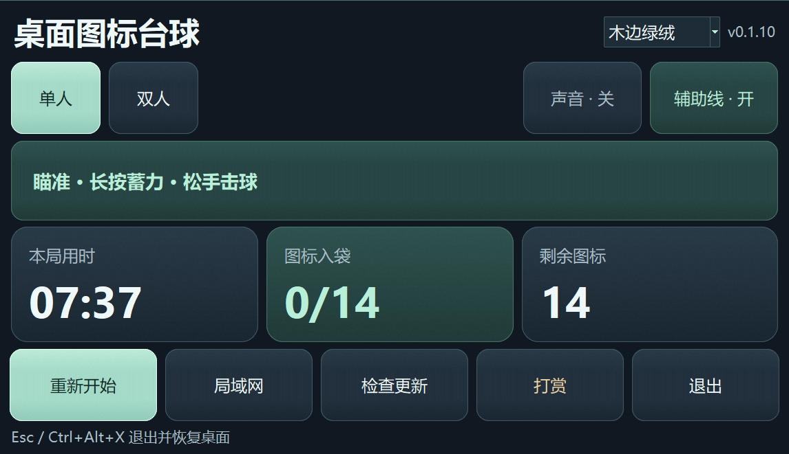

# 桌面图标台球

把 Windows 桌面上的图标变成带号码的台球。球面保留原图标，方便辨认。你可以独自清台，也可以和朋友共用一台电脑轮流击球。

**Windows 10 / 11 x64 · 单文件 EXE · 支持单人、本地双人和局域网双人**



## 下载

从 [GitHub Releases](https://github.com/nobcdz/desktop-icon-billiards/releases) 下载单文件程序，双击 `DesktopIconBilliards-<版本>-win-x64.exe` 即可运行。下文以 **v0.1.10 源码**为准，可按文末步骤构建该版本。

## 快速上手

1. 启动程序，等桌面图标在主屏幕上排成球阵。默认进入单人模式。
2. 移动鼠标瞄准，按住左键蓄力，松手击球。按下的位置旁会显示力度条。
3. 在磨砂控制面板上查看本局用时、入袋数和剩余图标数。切换「单人」或「双人」会重新摆球。联机对战从「局域网」进入。
4. 点击「退出」或按 `Esc` 结束游戏。也可以用全局快捷键 `Ctrl+Alt+X` 退出并恢复桌面。

### 单人和双人

| 模式 | 规则 |
| --- | --- |
| 单人 | 将编号球全部打入袋，清台后查看总用时。 |
| 双人 | 两人共用鼠标。每打进一颗编号球得 1 分，进球可续杆。没进球或白球入袋时，球停稳后换人。面板高亮当前玩家，清台后得分高者获胜，同分为平局。 |

白球入袋后会尝试自动摆回。如果没有合适的位置，可以点击台面空处摆球。「重新开始」会清除用时和得分，按当前模式重新摆球。

开局时母球在台面左侧四分之一处，右侧的三角球阵尖端朝向母球。最后一列球数不足时仍保留交错间距。

### 局域网对战

1. 两台电脑接入同一局域网，并运行相同版本的程序。
2. 房主点击「局域网」→「创建房间」，把本机 IPv4 地址和 8 位房间码发给朋友。Windows 防火墙弹出提示时，房主允许程序访问专用网络。房间使用 TCP `49321`。
3. 另一台电脑点击「局域网」，输入房主的 IPv4 地址和房间码，选择「加入房间」。房主为玩家 1，加入者为玩家 2。双方按双人规则轮流击球。

房间码验证通过后，双方使用房主的编号球和球面图标。比分、球位、瞄准、碰撞和落袋由房主同步。房主可以重新开始本局。点击「离开房间」或连接中断后，程序回到本地模式。

### 球台外观

在主窗口上方选择「木边绿绒」或「经典桌面」。木边绿绒使用内置球台图片，经典桌面使用当前 Windows 壁纸作为台面。切换会重新摆球，并记住下次启动时使用的样式。联机对战采用房主选择的球台样式。

### 辅助线和音效

- **辅助线**：白线显示白球首次碰撞前的路线，蓝线显示白球碰球或碰库后的方向，绿线显示被撞球的方向。线路随蓄力变化。
- **声音**：每次启动默认关闭。点击「声音 · 关」可开启实录的球球碰撞声和编号球落袋声。

## 从源码运行

需要 Windows 10 / 11 x64、Explorer 桌面和带 Tk 的 Python。以下命令使用 [uv](https://docs.astral.sh/uv/) 安装 Python 3.12 和运行依赖。

```powershell
uv venv --managed-python --python 3.12 .venv
uv pip install --python .\.venv\Scripts\python.exe -r requirements.txt
.\run.cmd
```

如果双击 `run.cmd` 后没有窗口，可以在 PowerShell 中运行 `.\.venv\Scripts\python.exe -X utf8 app.pyw` 查看错误。遇到 Explorer 访问权限问题时，请从当前登录用户的普通桌面会话启动。

## 构建和测试

构建需要 PowerShell 7 和 uv。

```powershell
pwsh -File build.ps1
.\.venv\Scripts\python.exe -m unittest discover -s tests -t . -v
```

EXE 输出到 `dist/`。版本取自 `dib/__init__.py`，构建脚本会打印文件大小和 SHA-256。已有构建环境时，可用 `pwsh -File build.ps1 -SkipDeps`。发布配置见 [更新清单与发布流程](docs/UPDATE.md)。

## 桌面恢复与隐私

游戏需要桌面图标处于显示状态，同一时间运行一个实例。游戏图层通过 Windows Shell 读取图标缩略图和布局。球台显示在主屏幕工作区，Windows 壁纸设置保持原样。程序不截取桌面画面，也不录音。

退出时会恢复桌面图标。若进程异常退出，独立看门狗会尝试恢复。运行日志和恢复记录位于 `%TEMP%\DesktopIconBilliards`。游戏期间更改屏幕布局、分辨率或 DPI 会结束本局并恢复桌面。

## 打赏

欢迎使用微信扫码给 Ivan 赞赏。


## 许可证与素材鸣谢

项目采用 [MIT 许可证](LICENSE)，原项目版权归 LXG（2025–2026）。[原项目](https://github.com/liuxiaogang-com/desktop-icon-billiards)

- 碰撞录音由 Za-Games 提供，采用 CC0 许可。[billiard ball clack](https://freesound.org/people/Za-Games/sounds/539854/)
- 落袋录音由 jtroan 提供，采用 CC BY 3.0 许可，已转换为 44.1 kHz PCM WAV。[Pool Ball in pocket.wav](https://freesound.org/people/jtroan/sounds/241373/) · [许可条款](https://creativecommons.org/licenses/by/3.0/)
